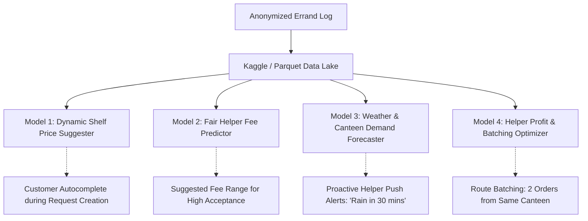

# Need It — Future AI Roadmap & Dataset Pipeline

This document defines the architectural specification for the future AI
pipeline. As decreed by **ADR D14**, there is **zero AI runtime execution
during the pilot phase**. Instead, the platform focuses on privacy-preserving,
high-fidelity data collection to construct a campus errand dataset (hosted
privately or via Kaggle Datasets) for fine-tuning recommendation and pricing
models post-pilot.

---

## 1. Principles & Privacy Policy

Campus errands handle sensitive personal routines: hostel room deliveries,
medications, late-night food, and peer transactions. The AI data pipeline must
guarantee complete de-identification before any record enters the dataset pool.

### The Inviolable Privacy Invariants:
1. **Zero PII in Training Data:** Student names, roll numbers, hostel room
   numbers, phone numbers, email addresses, and UPI IDs are **NEVER** stored in
   the training dataset.
2. **Spatial Anonymization:** Pickups and deliveries are mapped to broad campus
   cluster IDs (e.g., `cluster_vkv_block`, `cluster_canteen_annapoorna`), never
   exact room or floor coordinates.
3. **Temporal Jittering:** Timestamps are recorded as hour-of-day, day-of-week,
   and calendar month rather than exact microsecond logs.
4. **Aggregated Quantities:** Private personal notes or free-text chat messages
   are scrubbed; only normalized item category names and quantities are retained.

---

## 2. Canonical Errand Dataset Schema (Parquet / Kaggle)

The dataset exports into a standard relational/tabular Parquet format, optimized
for regression, classification, and sequence modeling:

| Column Name | Data Type | Description | Example |
|---|---|---|---|
| `order_hash` | String | Salted SHA-256 hash of order ID (one-way, deduped) | `a8f3b0...` |
| `day_of_week` | Integer | 0 (Monday) through 6 (Sunday) | `4` (Friday) |
| `hour_of_day` | Integer | 0 through 23 (campus local time) | `22` (10 PM) |
| `is_exam_season` | Boolean | True during mid-terms or end-semester finals | `true` |
| `weather_condition` | Categorical | `clear`, `rain`, `heavy_rain`, `extreme_heat` | `rain` |
| `temp_celsius` | Float | Ambient campus temperature | `28.5` |
| `pickup_cluster` | Categorical | Normalized store/spot identifier | `canteen_main` |
| `delivery_cluster` | Categorical | Normalized hostel block identifier | `hostel_boys_cluster_a` |
| `item_count` | Integer | Number of distinct items requested | `3` |
| `item_categories` | Array[String] | Standardized categories of requested goods | `["beverage", "hot_snack"]` |
| `estimated_goods_total` | Float | Customer's initial estimated cost in ₹ | `120.00` |
| `actual_goods_total` | Float | Confirmed shelf price in ₹ from receipt | `135.00` |
| `helper_fee` | Float | Helper delivery fee in ₹ | `30.00` |
| `time_to_accept_sec` | Integer | Seconds elapsed from creation to helper accept | `42` |
| `time_to_deliver_sec` | Integer | Seconds elapsed from accept to OTP handover | `1140` |
| `fulfillment_status` | Categorical | `completed`, `cancelled_pre_buy`, `cancelled_post_buy` | `completed` |
| `customer_rating` | Integer | Star rating given to helper (1–5, null if skipped)| `5` |
| `helper_rating` | Integer | Star rating given to customer (1–5, null if skipped)| `5` |

---

## 3. Future AI Capabilities & Model Tasks

Once the pilot logs $\ge 1,000$ verified completed transactions, the dataset
enables training specialized, low-latency micro-models:

### 1. Dynamic Shelf Price Estimation (Regression / Vector Search)
* **Problem:** Customers guessing item prices often guess too low, leading to
  helper hesitation or rejected price approvals.
* **Model Task:** Given item name embeddings and store cluster, predict the
  expected shelf price $\pm \sigma$ tolerance based on recent approved shelf
  photo actuals.
* **Benefit:** When creating an errand, typing "Amul Cool Cafe" automatically
  suggests `₹35` based on yesterday's approved receipts.

### 2. Fair Helper Fee Recommendation (Acceptance Rate Optimization)
* **Problem:** If a customer sets a ₹20 fee during pouring rain or for a 2 km
  cross-campus walk, the request sits unclaimed.
* **Model Task:** Predict the probability curve $P(\text{accepted within 3 mins})$
  as a function of `(fee, distance_cluster, weather, hour_of_day)`.
* **Benefit:** UI shows a dynamic badge: *"₹25 (Standard) · ₹35 (High-chance during rain)"*.

### 3. Weather & Campus Event Demand Forecasting
* **Problem:** Helpers stay in hostels when canteens are crowded, unaware that
  dozens of peers want deliveries.
* **Model Task:** Time-series demand forecasting conditioned on weather API
  signals (e.g., sudden downpour $\implies +300\%$ demand spike for tea and snacks)
  and academic calendar events (exam study nights $\implies$ midnight print/food orders).
* **Benefit:** Proactively alerts active helpers: *"High demand expected at Canopy Canteen tonight. Helpers earning ~₹150/hr."*

### 4. Route Batching & Profit Maximization
* **Problem:** A helper walks to a store for one ₹25 errand, while another student
  in the same hostel just requested items from the same canteen.
* **Model Task:** Multi-stop combinatorial route batching with sub-50ms latency.
* **Benefit:** One helper accepts two orders from the same canteen heading to the
  same hostel block, doubling their payout per trip.

---

## 4. Pipeline Instrumentation & Export CLI

To enable zero-overhead data collection during the pilot:
- Transactions write an anonymized entry into an internal `AnalyticsEvent` ledger
  upon `order.status == 'completed'`.
- A Django management command `python manage.py export_errand_dataset` dumps
  de-identified Parquet and CSV files for researchers and founder analysis.
